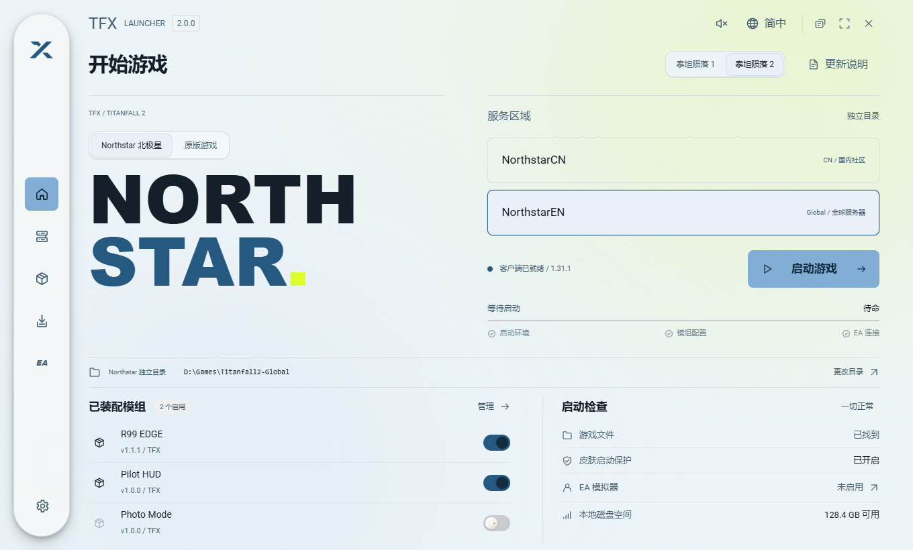
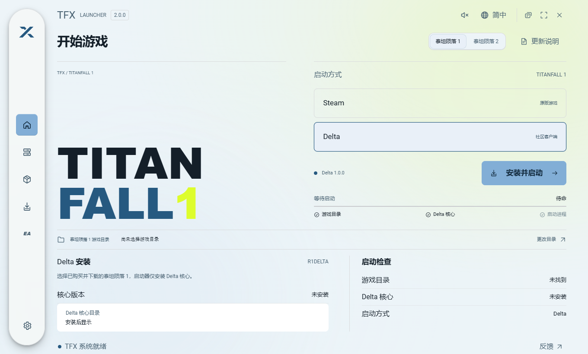
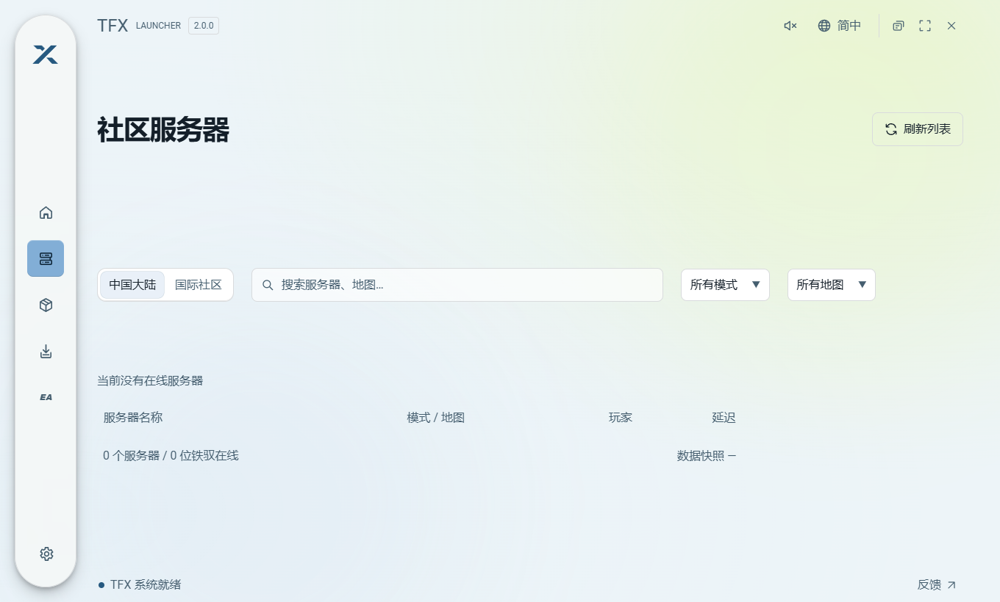
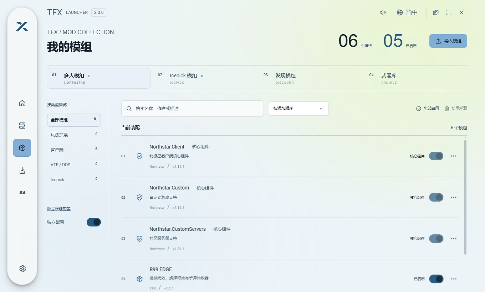
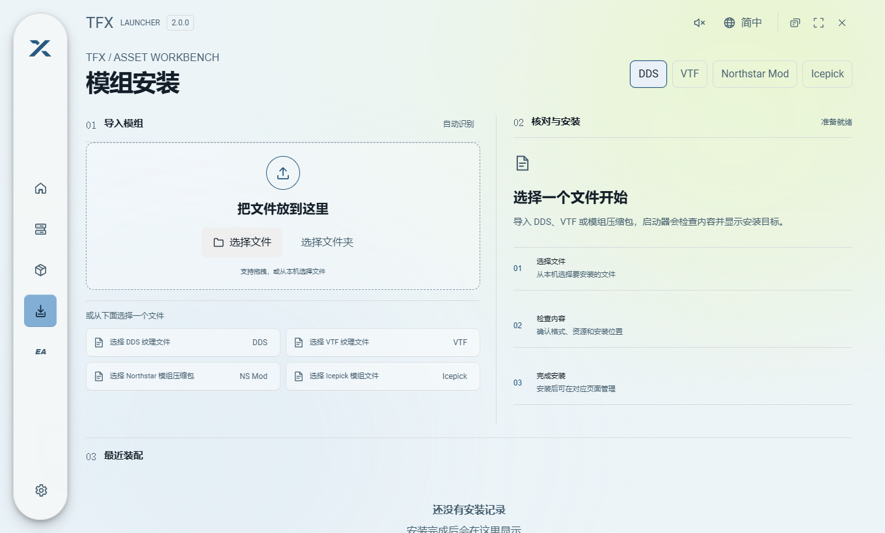
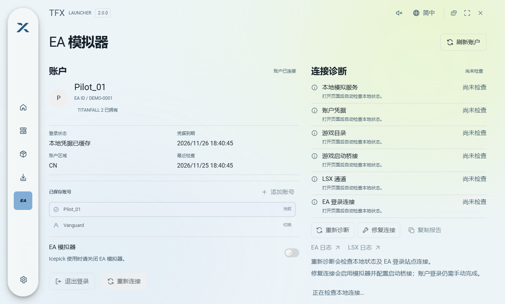
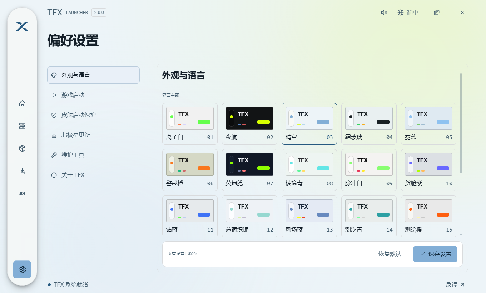

# TFX Launcher

**English** · [简体中文](README.zh-CN.md)

### Titanfall 1 (R1Delta) & Titanfall 2 (Northstar CN / Global). EA Emulator. Mods and skins. One launcher.

TFX is a Windows launcher for **TITANFALL 1** and **TITANFALL 2**, combining **R1Delta**, **NorthstarCN**, **Northstar Global**, vanilla launching (including VanillaPlus), an integrated **EA Emulator**, and a unified **Icepick / Northstar Mod / DDS / VTF** installation and Arsenal workspace.

[**Download 2.0.0**](https://github.com/harrycaoguitar/TFX_Launcher_forNorthStar/releases/tag/2.0.0) · [**Latest release**](https://github.com/harrycaoguitar/TFX_Launcher_forNorthStar/releases/latest) · [Report an issue](https://github.com/harrycaoguitar/TFX_Launcher_forNorthStar/issues) · [Build from source](BUILD.md)



> Screenshots show the **TFX Launcher 2.0.0** interface. Example servers, paths, and counts are demonstration data.

## What's new in 2.0.0

- **Redesigned 2.0 interface & new brand icon:** cleaner Start Game layout, 10 curated themes, 5 interface languages, and a new space-black titanium squircle launcher icon.
- **TITANFALL 1 (R1Delta) support:** switch between Titanfall 1 and Titanfall 2 right from the header, with R1Delta core installation, Steam vanilla launch, dedicated servers, and mod management.
- **Much faster region switching & launch checks:** optimized Windows process inspection and parallelized client SHA-256 verification / directory-rotation scanning without weakening any integrity or rollback protection.
- **Unified mod & skin workspace:** manage Northstar multiplayer mods, Icepick campaign mods, Thunderstore discovery, and the DDS / VTF Arsenal in one structured view, plus drag-and-drop auto-detection in Mod Installer.
- **Integrated EA Emulator:** sign in, switch EA accounts, run diagnostics, and keep the service running in the system tray.
- **Windows x64 installer & synced source:** unified 2.0.0 version metadata with 5 installer languages, custom install directory, optional shortcuts, and uninstaller.

[Read the bilingual release notes](RELEASE_NOTES_2.0.0.md).

## What you can do

| Workspace | Features |
|---|---|
| Start Game (TF2) | NorthstarCN, Northstar Global, and Vanilla (with optional VanillaPlus Mods); fast region switching, client status, and launch checks |
| Start Game (TF1) | R1Delta community client and Steam vanilla launching; R1Delta core installation and directory management |
| Community Servers | Browse and search public servers by name, map, or mode across NorthstarCN, Northstar Global, and R1Delta |
| My Mods | Manage Northstar multiplayer mods, Icepick campaign mods, Thunderstore discovery, and the weapon skin Arsenal |
| Mod Installer | Drop any compatible Icepick, Northstar Mod, DDS, or VTF archive/folder for automatic type detection and guided installation |
| EA Emulator | EA sign-in, account switching, local service status, tray mode, and one-click diagnostics |
| Preferences | 10 visual themes, 5 interface languages, launch arguments, independent server mod profiles, maintenance, and update controls |

## Interface gallery

| Titanfall 1 (R1Delta) | Community Servers |
|:---:|:---:|
|  |  |
| My Mods & Arsenal | Unified Mod Installer |
|  |  |
| EA Emulator | Preferences & Themes |
|  |  |

## Download and install

**Windows x64.** A purchased, installed copy of TITANFALL 2 (and/or TITANFALL 1 for R1Delta) is required. TFX does not include the games. Prepare a working Steam / EA environment and sufficient free disk space for client folders, caches, and skin backups.

1. Open the [2.0.0 release](https://github.com/harrycaoguitar/TFX_Launcher_forNorthStar/releases/tag/2.0.0) and download **`TFX-Launcher-2.0.0-Setup.exe`**.
2. Choose your installer language: **简体中文, 繁體中文, English, Deutsch, or Français**.
3. Select the installation folder and optional Desktop shortcut. Start Menu shortcuts and an uninstaller are included.
4. Launch TFX and point it to your existing game directory containing `Titanfall2.exe` (or `Titanfall.exe` for Titanfall 1).
5. Pick your game, mode, and server region, install the selected client when prompted, and click **Launch**.

The default launcher install location is `%LOCALAPPDATA%\Programs\TFX Launcher`. **The launcher installation directory and your game directories are separate settings.** Close any previous launcher instance before upgrading.

## NorthstarCN, Global, and VanillaPlus

- **Separate or shared game directories:** CN and Global Northstar clients can either share a single game root (using fast atomic directory rotation) or use separate NTFS folders.
- **Version clarity:** **TFX 2.0.0** is the launcher version, separate from the installed Northstar / R1Delta client versions displayed on the home screen.
- **Vanilla & VanillaPlus:** Play the campaign or official multiplayer via **Vanilla**, or enable **With Mods** to run VanillaPlus with compatible client-side mods.

## Mods, Icepick, and skins

Drop a compatible archive (`.zip`, `.7z`, `.rar`) or folder into **Mod Installer**. TFX automatically detects whether it is an **Icepick**, **Northstar Mod**, **DDS**, or **VTF** package and guides it into the matching install flow with backup and rollback protection.

- **My Mods** separates Northstar multiplayer mods, **Icepick** campaign mods, **Thunderstore** discovery, and the **Arsenal** (weapon-grouped DDS / VTF history and original-resource restoration).
- Close the game before modifying mods or skin resources.

## Development

The `main` branch contains the full 2.0.0 application source, build scripts, and NSIS installer project.

On Windows x64 with **Node.js 22.12+** (Node.js 24 recommended):

```powershell
npm ci
npm start
```

```powershell
npm test               # Run unit & safety tests
npm run build:win      # Build the branded NSIS setup installer
```

The runtime is pinned to **Electron 43.1.1**. See [BUILD.md](BUILD.md) for full build details and offline-runtime options.

## Help and contributors

For support, open a [GitHub Issue](https://github.com/harrycaoguitar/TFX_Launcher_forNorthStar/issues) or email **harrycaoguitar@gmail.com**. Include the launcher version, selected game/region, reproduction steps, and error details (redact any account tokens or private paths).

**Author:** HarryCao  
**Partner:** southstar

**Special thanks**, in the original order:

- **Northstar**
- **NorthstarCN**
- **Glock-雨夜**
- **HK560**
- **zxcPandora**
- **R1Delta Team**

Thanks also to **R1Delta**, **CrazyZhang666 / EAappEmulater**, the **Icepick** project, and all upstream developers, testers, and players who contributed feedback.

TFX is a **GPL-3.0-or-later** derivative of ViperCN 1.11.3. Inherited attribution and source obligations remain. See [LICENSE](LICENSE) and [THIRD_PARTY_NOTICES.md](THIRD_PARTY_NOTICES.md); bundled clients, mods, fonts, and tools retain their respective licenses.

TFX is a community project with no affiliation with or endorsement by Respawn Entertainment or Electronic Arts. TITANFALL and TITANFALL 2 names and assets belong to their respective rights holders.
