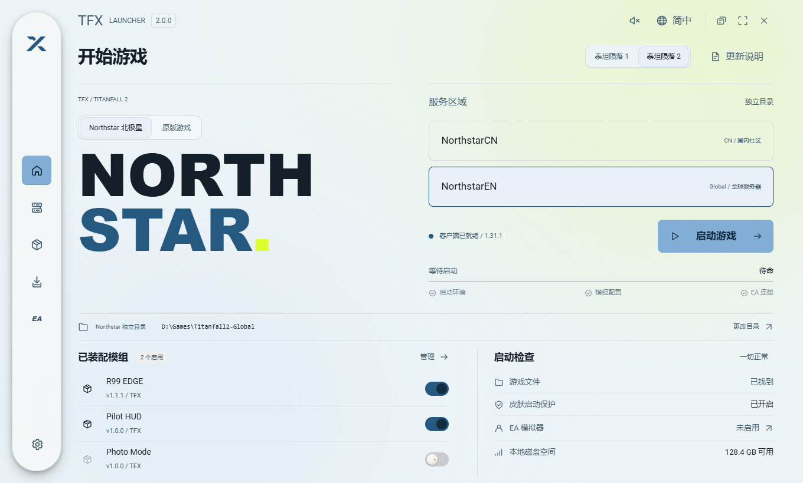
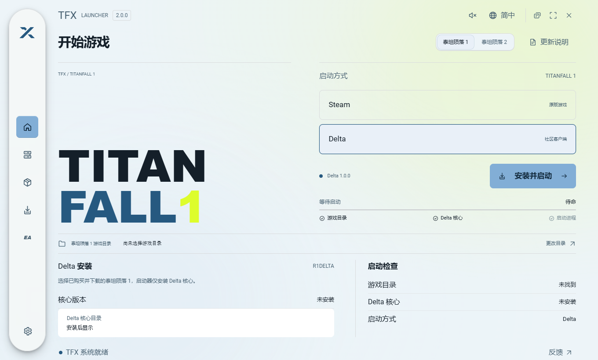
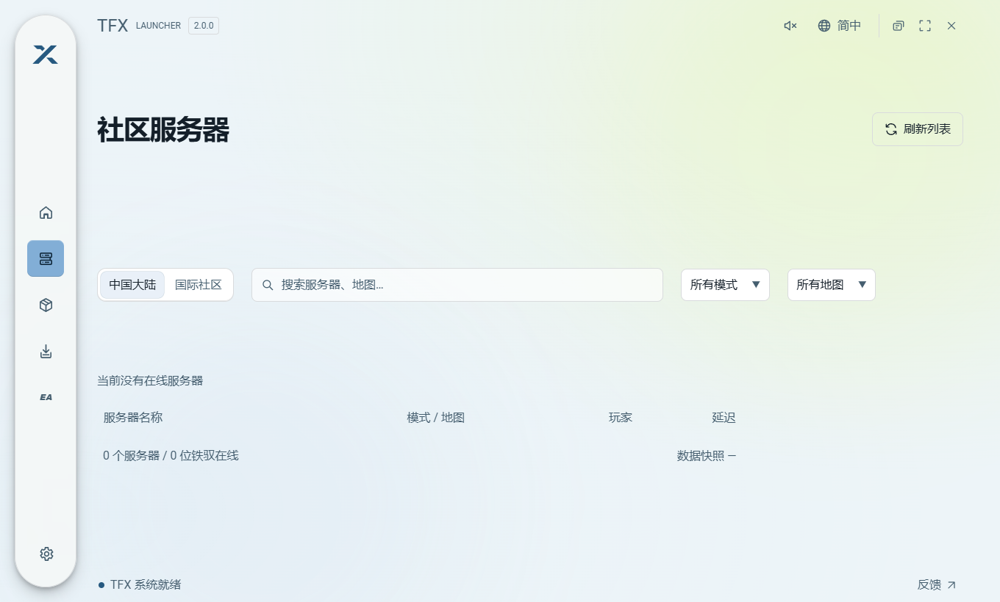
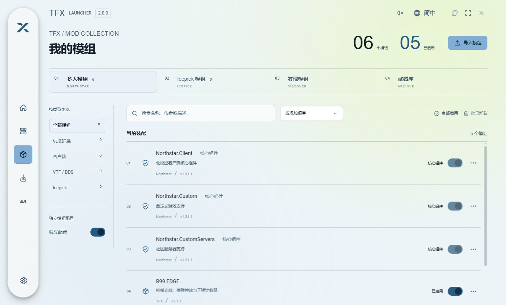
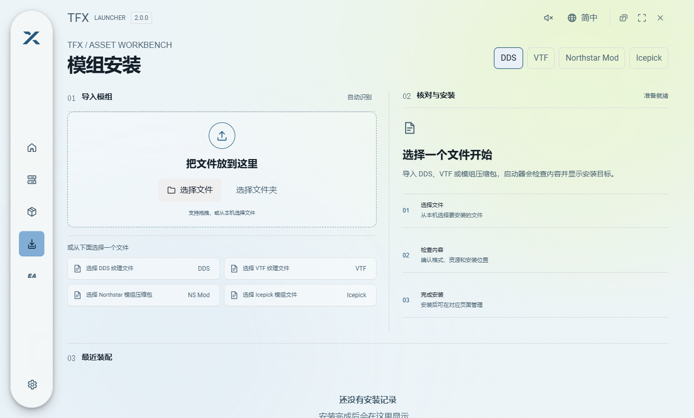
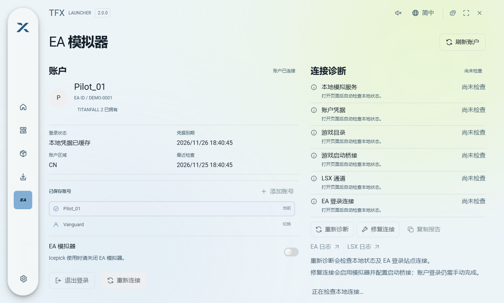
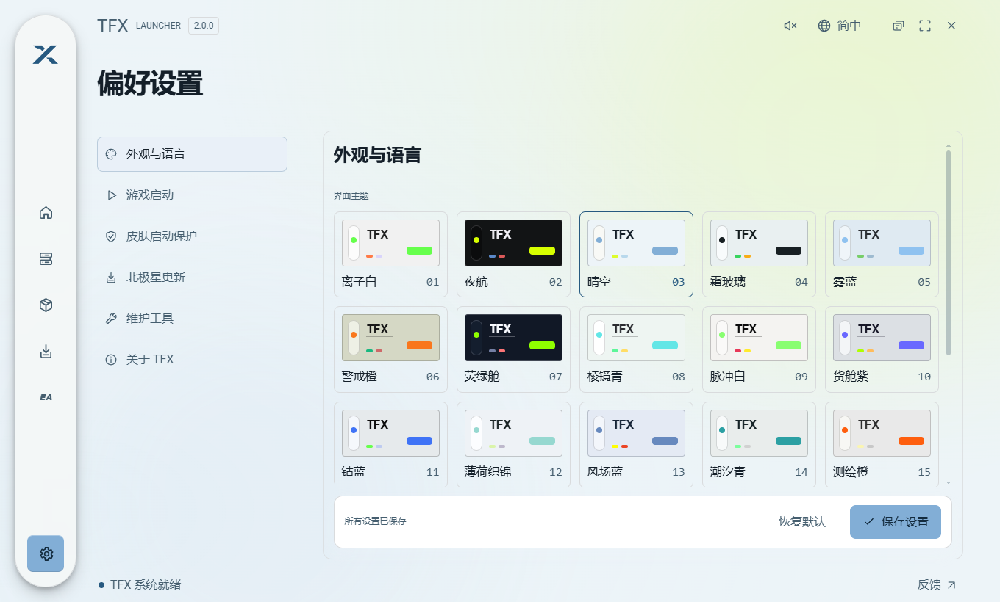

# TFX Launcher

[English](README.md) · **简体中文**

### 泰坦陨落 1（R1Delta）与泰坦陨落 2（北极星国服 / 全球服）、EA 模拟器、模组与皮肤，一个启动器全部搞定。

TFX 是面向 **《泰坦陨落 1》** 与 **《泰坦陨落 2》** 的 Windows 启动器，整合 **R1Delta**、**NorthstarCN 国服**、**Northstar 全球服**、原版与 VanillaPlus 启动、内置 **EA 模拟器**，以及 **Icepick / Northstar Mod / DDS / VTF** 统一安装与武器库工作区。

[**下载 2.0.0**](https://github.com/harrycaoguitar/TFX_Launcher_forNorthStar/releases/tag/2.0.0) · [**最新版本**](https://github.com/harrycaoguitar/TFX_Launcher_forNorthStar/releases/latest) · [反馈问题](https://github.com/harrycaoguitar/TFX_Launcher_forNorthStar/issues) · [源码构建](BUILD.md)



> 截图展示 **TFX Launcher 2.0.0** 实机界面。页面中的服务器、路径与数量为演示数据。

## 2.0.0 更新重点

- **全新 2.0 界面与品牌图标：** 精简首页排版、移除冗余次级入口，提供 10 套精细主题与 5 种界面语言，并启用全新深空黑钛银圆角品牌图标。
- **新增《泰坦陨落 1》（R1Delta）完整支持：** 顶部一键切换《泰坦陨落 1》与《泰坦陨落 2》，支持 R1Delta 核心安装与更新、Steam 原版启动以及专属社区服务器与模组管理。
- **切服启动「检查环境」大幅提速：** 优化 Windows 进程检查与短窗安全复用，并将客户端校验、目录轮换扫描与 SHA-256 哈希计算改为有界并发 + 祖先目录缓存，零安全妥协的前提下显著缩短切服等待。
- **统一模组与皮肤工作区：** 在「我的模组」中整合 Northstar 多人模组、Icepick 战役模组、Thunderstore 发现与武器库（DDS / VTF 皮肤历史与原版恢复）；「模组安装」支持拖入自动识别并引导安装。
- **内置 EA 模拟器工作区：** 支持 EA 账号登录与切换、连接状态诊断及系统托盘驻留运行。
- **Windows x64 正式安装器与同步源码：** 统一 2.0.0 版本信息，支持 5 种安装语言、自定义安装目录、可选快捷方式与卸载程序。

[查看中英文更新说明](RELEASE_NOTES_2.0.0.md)。

## 功能一览

| 工作区 | 可以做什么 |
|---|---|
| 开始游戏（泰坦 2） | 启动北极星国服、全球服与原版（支持 VanillaPlus 带 Mod 模式）；快速切服、检查客户端状态与启动环境 |
| 开始游戏（泰坦 1） | 支持 R1Delta 社区客户端与 Steam 原版启动；R1Delta 核心安装、更新与游戏目录管理 |
| 社区服务器 | 浏览并按名称、地图、模式搜索 NorthstarCN、Northstar 全球服与 R1Delta 公开服务器 |
| 我的模组 | 统一管理 Northstar 多人模组、Icepick 战役模组、Thunderstore 发现与武器皮肤武器库 |
| 模组安装 | 拖入 Icepick、Northstar Mod、DDS 或 VTF 压缩包 / 文件夹，自动识别类型并进入安全安装流程 |
| EA 模拟器 | EA 账号登录、切换账号、本地服务状态查看、托盘驻留与一键诊断修复 |
| 偏好设置 | 10 套视觉主题、5 种界面语言、启动参数、分服独立模组配置、维护与更新选项 |

## 界面预览

| 泰坦陨落 1（R1Delta） | 社区服务器 |
|:---:|:---:|
|  |  |
| 我的模组与武器库 | 统一模组安装 |
|  |  |
| EA 模拟器 | 偏好设置与主题 |
|  |  |

## 下载与安装

支持 **Windows x64**。需要已购买并安装的《泰坦陨落 2》（游玩 R1Delta 需已安装《泰坦陨落 1》），启动器不包含游戏本体。请准备可用的 Steam / EA 环境，并为客户端、缓存和皮肤备份留出充足磁盘空间。

1. 前往 [2.0.0 发布页](https://github.com/harrycaoguitar/TFX_Launcher_forNorthStar/releases/tag/2.0.0)，下载 **`TFX-Launcher-2.0.0-Setup.exe`**。
2. 选择安装语言：**简体中文、繁體中文、English、Deutsch 或 Français**。
3. 选择安装目录与是否创建桌面快捷方式。安装器同时提供开始菜单入口与卸载程序。
4. 打开 TFX，选择包含 `Titanfall2.exe`（或泰坦陨落 1 `Titanfall.exe`）的现有游戏目录。
5. 选择游戏、启动模式与服务区域，按提示安装对应客户端后点击「启动游戏」。

默认启动器安装位置为 `%LOCALAPPDATA%\Programs\TFX Launcher`。**启动器安装目录与游戏目录是不同设置。** 升级前请先退出旧版本启动器。

## 国服、全球服与原版带 Mod

- **独立目录与共享目录：** 北极星国服与全球服既可共用同一游戏目录（通过高速原子目录轮换切服），也可分别指定独立的 NTFS 目录。
- **版本说明：** **TFX 2.0.0** 为启动器版本号，与首页显示的北极星 / R1Delta 客户端版本相互独立。
- **原版与 VanillaPlus：** 单人战役与官方多人可选择**原版**；开启「带 Mod」即可使用 VanillaPlus 与兼容的客户端模组。

## 模组、Icepick 与皮肤

在**模组安装**页面拖入兼容压缩包（`.zip` / `.7z` / `.rar`）或完整文件夹，启动器会自动识别 **Icepick / Northstar Mod / DDS / VTF** 类型并进入对应安装流程，全程提供备份与异常回滚保护。

- **我的模组** 将 Northstar 多人模组、**Icepick** 战役模组、**Thunderstore** 发现与**武器库**（按武器归类的 DDS / VTF 历史与原版恢复）清晰分区管理。
- 修改模组或皮肤资源前，请确保游戏已关闭。

## 开发与构建

`main` 分支包含完整的 2.0.0 应用源码、构建脚本与 NSIS 安装器工程。

Windows x64 环境，使用 **Node.js 22.12+**（推荐 Node.js 24）：

```powershell
npm ci
npm start
```

```powershell
npm test               # 运行单元与安全测试
npm run build:win      # 构建品牌 NSIS 安装器
```

运行时固定为 **Electron 43.1.1**。完整目录结构与离线运行时构建方式见 [BUILD.md](BUILD.md)。

## 支持与贡献者

问题与建议请提交 [GitHub Issue](https://github.com/harrycaoguitar/TFX_Launcher_forNorthStar/issues)，或邮件联系 **harrycaoguitar@gmail.com**。反馈时请附上启动器版本、所选游戏/区域、复现步骤与完整报错（分享日志前请隐去账号令牌与个人路径）。

**作者：** HarryCao  
**合作伙伴：** southstar

**特别鸣谢**（保留原有顺序）：

- **Northstar**
- **NorthstarCN**
- **Glock-雨夜**
- **HK560**
- **zxcPandora**
- **R1Delta 团队**

同时感谢 **R1Delta**、**CrazyZhang666 / EAappEmulater**、**Icepick** 项目，以及所有上游开发者、测试与反馈玩家。

TFX 是基于 ViperCN 1.11.3 的 **GPL-3.0-or-later** 衍生项目，保留继承内容的署名与对应源码义务。参阅 [LICENSE](LICENSE) 和 [THIRD_PARTY_NOTICES.md](THIRD_PARTY_NOTICES.md)；客户端、模组、字体与工具遵循各自许可。

TFX 为社区项目，与 Respawn Entertainment 或 Electronic Arts 无隶属或背书关系。《泰坦陨落》与《泰坦陨落 2》名称与素材属于各自权利人。
